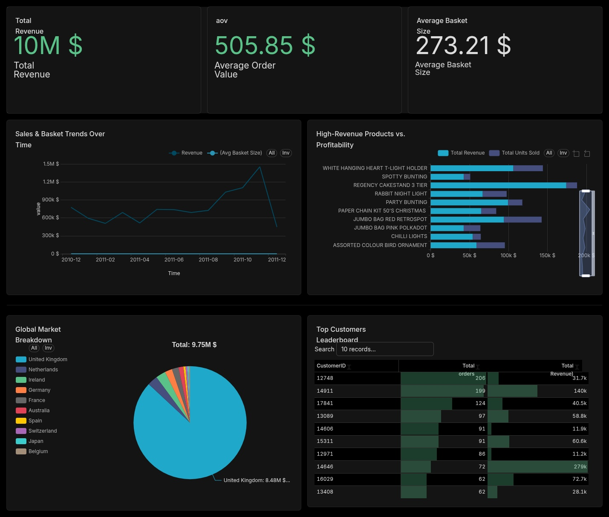

# 📊 E-Commerce Retail Sales Analysis & Customer Segmentation

> **End-to-end data analysis project** on the UCI Online Retail dataset — covering data cleaning, exploratory analysis, SQL-based KPI extraction, RFM scoring, and K-Means customer segmentation.

---

## 📋 Table of Contents

- [Overview](#overview)
- [Dataset](#dataset)
- [Project Structure](#project-structure)
- [Workflow](#workflow)
  - [1. Data Loading & Exploration](#1-data-loading--exploration)
  - [2. Data Cleaning & Preprocessing](#2-data-cleaning--preprocessing)
  - [3. Feature Engineering](#3-feature-engineering)
  - [4. Exploratory Data Analysis (EDA)](#4-exploratory-data-analysis-eda)
  - [5. Interactive Dashboard (Apache Superset)](#5-interactive-dashboard-apache-superset)
  - [6. SQL KPI Queries](#6-sql-kpi-queries)
  - [7. RFM Analysis](#7-rfm-analysis)
  - [8. K-Means Customer Segmentation](#8-k-means-customer-segmentation)
- [Key Findings](#key-findings)
- [Technologies Used](#technologies-used)
- [How to Run](#how-to-run)

---

## Overview

This project performs a full analytical pipeline on a **UK-based online retail** transactional dataset. The objective is to:

1. **Clean and prepare** raw transactional data for analysis.
2. **Explore** revenue patterns across time, geography, and products.
3. **Extract business KPIs** using SQL queries (revenue, AOV, basket size, retention, product affinity).
4. **Segment customers** using both rule-based RFM scoring and unsupervised K-Means clustering.
5. **Compare** the two segmentation approaches for consistency and insight.

---

## Dataset

| Property | Details |
|---|---|
| **Source** | [UCI Online Retail Dataset](https://archive.ics.uci.edu/ml/datasets/online+retail) |
| **Records** | 541,909 transactions (raw) → ~522,725 after cleaning |
| **Time Range** | December 2010 – December 2011 |
| **Geography** | 37+ countries (primarily United Kingdom) |
| **Business** | UK-based online retailer selling unique all-occasion gifts, mainly to wholesale customers |

### Raw Columns

| Column | Type | Description |
|---|---|---|
| `InvoiceNo` | String | Invoice number (prefix `C` = cancellation) |
| `StockCode` | String | Product code |
| `Description` | String | Product name |
| `Quantity` | Integer | Quantity purchased per transaction line |
| `InvoiceDate` | Datetime | Date and time of the invoice |
| `UnitPrice` | Float | Unit price in GBP (£) |
| `CustomerID` | Float/String | Unique customer identifier (NaN for guests) |
| `Country` | String | Customer's country |

---

## Project Structure

```
project/
├── analyse.ipynb         # Main Jupyter notebook (Python analysis)
├── My_sql.session.sql    # SQL queries for KPI analysis
├── data.csv              # Raw dataset (~45 MB, 541,909 rows)
├── cleaned_data.csv      # Cleaned dataset (~57 MB, 522,725 rows)
├── dashboard.jpg         # Apache Superset dashboard screenshot
└── README.md             # This file
```

---

## Workflow

### 1. Data Loading & Exploration

- Loaded raw CSV with `pandas` using `latin-1` encoding.
- Inspected shape (541,909 × 8), data types, and statistical summary via `df.describe()` and `df.info()`.
- Identified key data quality issues:
  - **135,080 missing** `CustomerID` values.
  - **1,454 missing** `Description` values.
  - **Negative quantities** (cancellations) and **negative unit prices**.
  - `InvoiceDate` stored as string, `CustomerID` as float.

### 2. Data Cleaning & Preprocessing

| Step | Action | Rationale |
|---|---|---|
| Remove duplicates | `df.drop_duplicates()` | Eliminate exact duplicate rows |
| Parse dates | Convert `InvoiceDate` to datetime | Enable time-based analysis |
| Handle missing CustomerID | Fill NaN with `"Guest"` | Preserve guest transactions for revenue analysis |
| Fill missing descriptions | Replace NaN with `"No description"` | Avoid losing valid transaction rows |
| Remove cancellations | Drop rows where `InvoiceNo` starts with `"C"` | Cancellations distort revenue/quantity metrics |
| Filter positive Quantity | Keep `Quantity > 0` | Remove returns and adjustments |
| Filter positive UnitPrice | Keep `UnitPrice > 0` | Remove erroneous zero/negative prices |
| Remove non-products | Exclude `"POSTAGE"` and `"Manual"` descriptions | These are fees/adjustments, not product sales |
| Remove Quantity outliers | Drop rows with `Quantity > 50,000` | 2 extreme outliers manually identified via boxplot |
| Remove UnitPrice outliers | Drop rows with `UnitPrice > 2,000` | 2 extreme outliers remaining after description filtering |

### 3. Feature Engineering

New columns derived from cleaned data:

| Feature | Formula / Method | Purpose |
|---|---|---|
| `Revenue` | `Quantity × UnitPrice` | Core metric for all KPI analysis |
| `Year` | `InvoiceDate.dt.year` | Year-level aggregation |
| `Month` | `InvoiceDate.dt.month` | Monthly trend analysis |
| `Day` | `InvoiceDate.dt.day` | Daily pattern analysis |
| `Hour` | `InvoiceDate.dt.hour` | Hourly revenue pattern analysis |

### 4. Exploratory Data Analysis (EDA)

#### Revenue by Hour
- Revenue rises from **9 AM**, peaks around **12 PM (noon)**, stays strong during business hours, and drops sharply after **5 PM**.
- Indicates a **B2B buying pattern** (wholesale customers ordering during work hours).

#### Revenue by Month (2011)
- Strong seasonal pattern: revenue surges from **September to November**.
- **November** is the peak revenue month — driven by Black Friday and Christmas stock preparation.
- December shows a sharp drop (dataset ends on Dec 9, 2011).

### 5. Interactive Dashboard (Apache Superset)

An interactive BI dashboard was built using **Apache Superset** connected to the cleaned MySQL dataset. The dashboard provides a real-time, visual overview of all core business KPIs.



#### Dashboard Panels

| Panel | Chart Type | Description |
|---|---|---|
| **Total Revenue** | Big Number | Overall revenue: **$10M** |
| **Average Order Value (AOV)** | Big Number | AOV: **$505.85** |
| **Average Basket Size** | Big Number | Avg basket: **$273.21** |
| **Sales & Basket Trends Over Time** | Line Chart | Monthly revenue trend from Dec 2010 to Dec 2011, showing the November peak |
| **High-Revenue Products vs. Profitability** | Horizontal Bar | Top 10 products comparing total revenue vs. total units sold |
| **Global Market Breakdown** | Pie Chart | Revenue distribution by country — UK dominates with **$8.48M** (87% of total) |
| **Top Customers Leaderboard** | Table | Top 10 customers ranked by total orders and total revenue, with Customer 12748 leading at 206 orders |

---
## 📁 Apache Superset Dashboard Configurations

The `superset_dashboard/` directory contains the complete blueprint of the BI dashboard exported as a text-based asset matrix, allowing you to replicate the entire environment seamlessly.
```
📁 superset_dashboard/
├── dashboards/   # JSON layouts defining chart positioning, grids, & CSS overrides
├── charts/       # Declarative YAML mapping slices, axis rules, & metric configurations
└── datasets/     # YAML metadata declaring virtual schemas & underlying SQL queries
```

### 📦 Asset Breakdown

| Component | Format | Description |
| :--- | :--- | :--- |
| **Dashboards** | `JSON` | Stores the visual structure, grid placement, and responsive layout parameters of the main reporting interface. |
| **Charts** | `YAML` | Contains granular visualization configurations, color palettes, metric aggregations, and query filters for individual slices. |
| **Datasets** | `YAML` | Declares database connection mapping, semantic layer columns, custom calculated metrics, and physical-to-virtual table schemas. |

### 📥 How to Import

To restore this interactive dashboard to your local Apache Superset instance, follow these steps:

1. Compress the entire contents of the `superset_dashboard/` folder into a single `.zip` archive.
2. Open your **Apache Superset** UI web interface.
3. Navigate to the **Dashboards** tab in the top navigation bar.
4. Click the **Import Dashboard** icon *(the upload arrow icon located in the top-right corner)*.
5. Upload your created `.zip` package. Superset will automatically parse the schemas, rebuild the charts, and reconstruct the dashboard layout.

> ⚠️ **Note:** Ensure your underlying database connection profile matches the schema defined in the `datasets/` files to allow immediate query execution.

### 6. SQL KPI Queries


The `KPI.sql` file contains structured SQL queries run against the `cleaned_sales_data` table (loaded into MySQL). Key analyses include:

| KPI | Query Description |
|---|---|
| **Top Revenue Products** | Top 10 products by total revenue (all-time and November 2011) |
| **Top Customers by Revenue** | Top 5 customers overall and in November 2011 (excluding guests) |
| **Revenue by Country** | Top 10 countries by total revenue |
| **Retention & Loyalty** | Repeat buyer analysis — total orders, total spend, and average order value per customer |
| **Product Popularity vs. Profitability** | Compare units sold vs. revenue generated per product |
| **Average Order Value (AOV)** | Monthly AOV = `SUM(Revenue) / COUNT(DISTINCT InvoiceNo)` |
| **Basket Size** | Average items per order by month |
| **Product Affinity (Market Basket)** | Co-purchase analysis using self-join on `InvoiceNo` to find frequently bought-together products |

### 7. RFM Analysis

RFM (Recency, Frequency, Monetary) analysis segments customers based on purchasing behavior:

| Metric | Definition |
|---|---|
| **Recency** | Days since the customer's last purchase |
| **Frequency** | Number of unique invoices (orders) |
| **Monetary** | Total revenue generated by the customer |

#### Scoring Method
- Each metric is divided into **5 quintiles** using `pd.qcut()`.
- **Recency**: lower is better → scores [5, 4, 3, 2, 1].
- **Frequency & Monetary**: higher is better → scores [1, 2, 3, 4, 5].
- Combined into an `RFM_Cell` string (e.g., `"555"` = best customer).

#### Rule-Based Segments

| Segment | R Score | F Score | Description |
|---|---|---|---|
| Champions | 4–5 | 4–5 | Recent, frequent, high-spend |
| Loyal Customers | 2–5 | 3–5 | Consistent buyers |
| Recent / New Buyers | 3–5 | 1–2 | Recently acquired, low frequency |
| About to Sleep | 2–3 | 1–2 | Declining engagement |
| Can't Lose Them | 1–2 | 3–5 | Once loyal, now dormant |
| Hibernating / Lost | 1–2 | 1–2 | Inactive, low value |

### 8. K-Means Customer Segmentation

An unsupervised clustering step used to validate and refine the rule-based RFM segments.

#### Preprocessing
1. **Log transformation** — `Recency` is transformed as `-np.log1p(Recency)`, while `Frequency` and `Monetary` use `np.log1p(...)` so that higher values are better for all features.
2. **Standardization** — `StandardScaler` is applied to normalize the transformed RFM variables before clustering.

#### Cluster Evaluation
- Evaluated **k = 2 to 8** using:
  - **Inertia** (elbow check)
  - **Silhouette Score** (cluster quality)
- The notebook plots both metrics and then selects **five clusters** for the final segmentation (`best_k = 5`).

#### Cluster Profiling
- K-Means is fitted on the scaled RFM features and assigns each customer a `KMeansCluster`.
- Cluster profiles are computed from the original RFM scale using mean `Recency`, `Frequency`, and `Monetary` values.
- Results are sorted by **Monetary** and then **Frequency** (descending), and the clusters are labeled from best to worst:
  - `Champions`
  - `Loyal Customers`
  - `Potential Growth`
  - `Needs Attention`
  - `At Risk`

#### Visualization
- **PCA (2 components)** is used to project the customer clusters into 2D space for scatter-plot visualization.
- A cross-tabulation compares the original RFM score segments with the K-Means segments to assess alignment.

---

## Key Findings

| Insight | Detail |
|---|---|
| 🕐 **Peak Revenue Hour** | 12 PM — consistent with B2B wholesale ordering patterns |
| 📅 **Peak Revenue Month** | November 2011 — Black Friday & pre-Christmas stocking |
| 🌍 **Top Market** | United Kingdom dominates revenue |
| 🛒 **Wholesale Behavior** | High quantities per order suggest primarily wholesale customers |
| 👥 **Customer Segments** | Champions and Loyal Customers drive the majority of revenue |
| 📊 **Segmentation Consistency** | K-Means clusters broadly align with rule-based RFM segments, validating both approaches |

---

## Technologies Used

| Tool | Purpose |
|---|---|
| **Python 3** | Core programming language |
| **Pandas** | Data manipulation and cleaning |
| **NumPy** | Numerical operations |
| **Matplotlib** | Static visualizations (bar charts, box plots) |
| **Seaborn** | Statistical visualizations (histograms, KDE, scatter) |
| **Scikit-learn** | K-Means clustering, PCA, StandardScaler, Silhouette Score |
| **MySQL** | KPI queries on cleaned data |
| **Apache Superset** | Interactive BI dashboard |
| **Jupyter Notebook** | Interactive analysis environment |

---

## How to Run

### Prerequisites

```bash
pip install pandas numpy matplotlib seaborn scikit-learn jupyter
```

### Download the Dataset

The CSV files are too large for GitHub. Download the raw data from the UCI repository:

1. Download from [UCI Online Retail Dataset](https://archive.ics.uci.edu/ml/datasets/online+retail)
2. Save the file as `data.csv` in the project root directory
3. Run the notebook — it will generate `cleaned_data.csv` automatically

### Run the Analysis

```bash
# Launch the notebook
jupyter notebook analyse.ipynb
```

### Run SQL Queries

1. Import `cleaned_data.csv` into a MySQL database as a table named `cleaned_sales_data`.
2. Execute the queries from `KPI.sql` in your MySQL client.

---

> **Author:** Saifi Omar El Khatab  
> **Dataset:** UCI Machine Learning Repository — Online Retail Dataset
