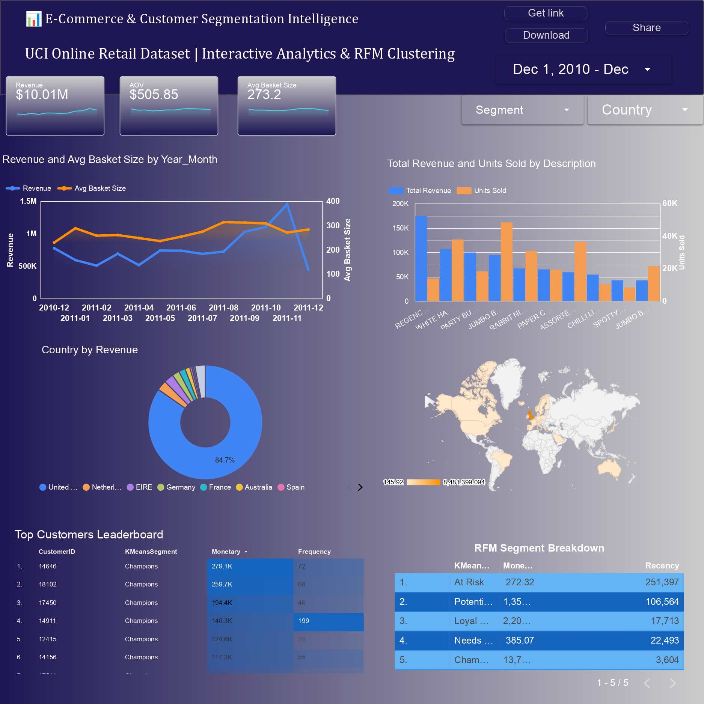

# E-Commerce Retail Sales Analysis & Customer Segmentation

**An end-to-end data analysis project** using the UCI Online Retail dataset, covering data cleaning, exploratory data analysis, SQL-based KPI extraction, interactive BI dashboards, RFM analysis, and K-Means customer segmentation.

## Table of Contents

- [Overview](#overview)
- [Dataset](#dataset)
- [Project Structure](#project-structure)
- [Workflow](#workflow)
  - [1. Data Loading & Exploration](#1-data-loading--exploration)
  - [2. Data Cleaning & Preprocessing](#2-data-cleaning--preprocessing)
  - [3. Feature Engineering](#3-feature-engineering)
  - [4. Exploratory Data Analysis](#4-exploratory-data-analysis-eda)
  - [5. Interactive Dashboard — Apache Superset](#5-interactive-dashboard-apache-superset)
  - [6. Interactive Dashboard — Google Looker Studio](#6-interactive-dashboard-google-looker-studio)
  - [7. SQL KPI Queries](#7-sql-kpi-queries)
  - [8. RFM Analysis](#8-rfm-analysis)
  - [9. K-Means Customer Segmentation](#9-k-means-customer-segmentation)
- [Key Findings](#key-findings)
- [Technologies Used](#technologies-used)
- [How to Run](#how-to-run)
- [Author](#author)

---

## Overview

This project analyzes a UK-based online retailer's transactional dataset to uncover sales trends, evaluate business performance, and understand customer purchasing behavior.

The main objectives are to:

1. **Clean and prepare** raw transactional data for reliable analysis.
2. **Explore sales patterns** across time, geography, and products.
3. **Extract business KPIs** using SQL, including revenue, average order value, basket size, customer loyalty, and product affinity.
4. **Build interactive dashboards** using Apache Superset and Google Looker Studio.
5. **Segment customers** using rule-based RFM scoring and unsupervised K-Means clustering.
6. **Compare segmentation approaches** to identify valuable customers and support customer retention strategies.

## Dataset

| Property | Details |
|---|---|
| **Source** | [UCI Online Retail Dataset](https://archive.ics.uci.edu/ml/datasets/online+retail) |
| **Raw records** | 541,909 transaction lines |
| **Cleaned records** | Approximately 522,725 rows |
| **Time range** | December 2010 – December 2011 |
| **Geography** | More than 37 countries, primarily the United Kingdom |
| **Business** | UK-based online retailer selling unique all-occasion gifts, mainly to wholesale customers |

### Raw Columns

| Column | Type | Description |
|---|---|---|
| `InvoiceNo` | String | Invoice number; prefix `C` indicates a cancellation |
| `StockCode` | String | Product identifier |
| `Description` | String | Product name |
| `Quantity` | Integer | Quantity purchased per transaction line |
| `InvoiceDate` | Datetime | Date and time of the invoice |
| `UnitPrice` | Float | Unit price in GBP (£) |
| `CustomerID` | Float/String | Customer identifier; missing for some transactions |
| `Country` | String | Customer's country |

---

## Project Structure

```text
project/
├── analyse.ipynb
├── My_sql.session.sql
├── KPI.sql
├── data.csv
├── cleaned_data.csv
├── dashboard.jpg
├── looker_studio_dashboard.png
├── superset_dashboard/
│   ├── dashboards/
│   ├── charts/
│   └── datasets/
└── README.md
```

**File descriptions:**

- `analyse.ipynb` — Python notebook for data cleaning, EDA, RFM analysis, and K-Means clustering.
- `My_sql.session.sql` — SQL session or working queries.
- `KPI.sql` — SQL queries for business KPI analysis.
- `data.csv` — Raw dataset.
- `cleaned_data.csv` — Processed dataset.
- `dashboard.jpg` — Apache Superset dashboard screenshot.
- `looker_studio_dashboard.png` — Google Looker Studio dashboard screenshot.
- `superset_dashboard/` — Dashboard configuration assets.

*Note: The filenames above should match the files actually present in your repository. Remove any entries for files you have not created.*

---

## Workflow

### 1. Data Loading & Exploration

- Loaded the raw CSV using Pandas with `latin-1` encoding.
- Inspected the dataset's dimensions, data types, and statistical summaries using `df.info()` and `df.describe()`.
- Identified data quality issues, including:
  - 135,080 missing `CustomerID` values.
  - 1,454 missing `Description` values.
  - Negative quantities associated with returns and cancellations.
  - Zero or negative unit prices.
  - Incorrect data types for `InvoiceDate` and `CustomerID`.

### 2. Data Cleaning & Preprocessing

| Step | Action | Rationale |
|---|---|---|
| Remove duplicates | `df.drop_duplicates()` | Eliminate exact duplicate rows |
| Parse dates | Convert `InvoiceDate` to datetime | Enable time-based analysis |
| Handle missing customer IDs | Replace missing values with `"Guest"` | Preserve transactions for sales analysis |
| Fill missing descriptions | Replace missing values with `"No description"` | Avoid unnecessarily losing transaction rows |
| Remove cancellations | Exclude invoices beginning with `C` | Focus on completed sales |
| Filter quantities | Keep `Quantity > 0` | Exclude returns and negative adjustments |
| Filter prices | Keep `UnitPrice > 0` | Exclude zero and negative prices |
| Remove non-product entries | Exclude `POSTAGE` and `Manual` descriptions | Focus on product sales |
| Handle quantity outliers | Remove identified extreme quantities above 50,000 | Reduce the effect of extreme observations |
| Handle price outliers | Remove identified prices above 2,000 | Reduce the effect of extreme observations |

**Result:** The cleaning process produced a dataset containing approximately 522,725 rows for downstream analysis.

### 3. Feature Engineering

Additional features were derived from the cleaned dataset.

| Feature | Formula / Method | Purpose |
|---|---|---|
| `Revenue` | `Quantity × UnitPrice` | Calculate sales revenue per transaction line |
| `Year` | `InvoiceDate.dt.year` | Annual comparisons |
| `Month` | `InvoiceDate.dt.month` | Monthly sales trends |
| `Day` | `InvoiceDate.dt.day` | Daily patterns |
| `Hour` | `InvoiceDate.dt.hour` | Hourly sales patterns |

### 4. Exploratory Data Analysis (EDA)

#### Revenue by Hour

- Revenue increases from approximately 9 AM and peaks around noon.
- Sales remain strong during business hours and decrease after approximately 5 PM.
- This pattern is consistent with business-hours purchasing behavior, although the dataset alone does not establish that every buyer is a wholesale customer.

#### Revenue by Month

- Revenue increases significantly from September to November 2011.
- November is the peak revenue month in the analyzed period.
- December shows a sharp decrease because the dataset ends on December 9, 2011.

#### Geographic and Product Analysis

- The United Kingdom represents the largest share of revenue.
- Product-level analysis helps identify high-revenue products and differences between sales volume and revenue contribution.
- Customer-level analysis highlights repeat purchasing and high-value customers.

### 5. Interactive Dashboard — Apache Superset

An interactive business intelligence dashboard was built using **Apache Superset**, connected to the cleaned MySQL dataset.

The dashboard provides an overview of sales performance, customer activity, and product trends.


#### Dashboard Panels

| Panel | Chart Type | Description |
|---|---|---|
| Total Revenue | Big Number | Overall sales revenue |
| Average Order Value | Big Number | Average revenue per order |
| Average Basket Size | Big Number | Average basket metric |
| Sales Trends | Line Chart | Monthly sales trends |
| Product Performance | Horizontal Bar Chart | Comparison of top products by revenue and units sold |
| Geographic Breakdown | Pie Chart | Revenue distribution by country |
| Top Customers | Table | Leading customers by orders and revenue |

The dashboard includes the following reported metrics:

- **Total revenue:** approximately $10 million.
- **Average order value:** approximately $505.85.
- **United Kingdom revenue:** approximately $8.48 million.
- **Leading customer:** Customer 12748, with 206 orders.

*These figures reflect the existing dashboard's reported values. Verify the currency, metric definitions, and aggregations against your SQL results before presenting them as final business KPIs.*

#### Apache Superset Dashboard Configurations

The `superset_dashboard/` directory contains the configuration assets used to organize the dashboard.

```text
superset_dashboard/
├── dashboards/
├── charts/
└── datasets/
```

| Component | Format | Description |
|---|---|---|
| Dashboards | JSON | Layout, chart placement, and dashboard structure |
| Charts | YAML | Chart configuration and visualization settings |
| Datasets | YAML | Dataset metadata, columns, and metric definitions |

**Importing the dashboard**

1. Prepare the dashboard export archive in the format supported by your Superset version.
2. Open your Apache Superset instance.
3. Navigate to the dashboard import functionality.
4. Upload the supported export archive.
5. Configure the database connection and validate the imported datasets and charts.

The precise export format and import steps depend on the Superset version and how the assets were exported.

### 6. Interactive Dashboard — Google Looker Studio

An interactive sales dashboard was also created using **Google Looker Studio** to present business insights through visual reporting.

**[View the Interactive Google Looker Studio Dashboard](https://datastudio.google.com/s/khGk9KWL8L0)**



#### Dashboard Objectives

The Looker Studio dashboard complements the Python analysis, SQL queries, and Apache Superset dashboard by providing an additional interactive reporting interface.

The dashboard can be used to explore the visualizations and KPIs configured in the report, such as:

- Sales performance and key business metrics.
- Revenue trends over time.
- Geographic sales distribution.
- Product performance.
- Customer purchasing behavior.

*The exact chart descriptions should be updated to match the visualizations present in the published dashboard.*

#### Dashboard Access

Open the [Looker Studio report](https://datastudio.google.com/s/khGk9KWL8L0) to view the dashboard.

For portfolio visitors to access it, configure the report's sharing permissions appropriately. Google Looker Studio supports sharing reports with specific viewers or through link-sharing settings.

---

### 7. SQL KPI Queries

The `KPI.sql` file contains structured SQL queries executed against the `cleaned_sales_data` table in MySQL.

| KPI | Analysis |
|---|---|
| Top Revenue Products | Rank products by total revenue overall and in November 2011 |
| Top Customers by Revenue | Identify high-value customers overall and in November 2011 |
| Revenue by Country | Compare revenue across countries |
| Retention & Loyalty | Analyze repeat buyers, order counts, total spend, and average order value |
| Product Popularity vs. Revenue | Compare units sold with revenue generated per product |
| Average Order Value | Calculate monthly revenue divided by distinct orders |
| Basket Size | Analyze the average number of items per order by month |
| Product Affinity | Use a self-join on `InvoiceNo` to identify products frequently purchased together |

#### Example KPI: Monthly Average Order Value

```sql
SELECT
    YEAR(InvoiceDate) AS sales_year,
    MONTH(InvoiceDate) AS sales_month,
    SUM(Revenue) / COUNT(DISTINCT InvoiceNo) AS average_order_value
FROM cleaned_sales_data
GROUP BY
    YEAR(InvoiceDate),
    MONTH(InvoiceDate)
ORDER BY
    sales_year,
    sales_month;
```

This query calculates monthly average order value by dividing total revenue by the number of distinct invoices.

### 8. RFM Analysis

RFM analysis segments customers based on three purchasing behavior metrics:

| Metric | Definition |
|---|---|
| **Recency** | Number of days since the customer's most recent purchase |
| **Frequency** | Number of distinct invoices associated with the customer |
| **Monetary** | Total revenue generated by the customer |

#### Scoring Method

- Each metric is divided into five quantile-based groups using `pd.qcut()`.
- **Recency:** Lower values receive higher scores.
- **Frequency:** Higher values receive higher scores.
- **Monetary:** Higher values receive higher scores.
- The individual scores are combined into an `RFM_Cell` string, such as `555`.

The reference date used to calculate recency should be defined consistently in the notebook.

#### Rule-Based Customer Segments

| Segment | R Score | F Score | Description |
|---|---|---|---|
| Champions | 4–5 | 4–5 | Recent, frequent, high-spending customers |
| Loyal Customers | 2–5 | 3–5 | Customers who purchase consistently |
| Recent / New Buyers | 3–5 | 1–2 | Recent customers with relatively few orders |
| About to Sleep | 2–3 | 1–2 | Customers showing declining engagement |
| Can't Lose Them | 1–2 | 3–5 | Previously frequent customers who are now inactive |
| Hibernating / Lost | 1–2 | 1–2 | Inactive customers with relatively low frequency |

These rules are illustrative segment definitions; the exact implementation in the notebook determines the final assignments.

### 9. K-Means Customer Segmentation

K-Means clustering was used as an unsupervised approach to complement the rule-based RFM segmentation.

#### Preprocessing

1. **Log transformation:** Recency was transformed using `-np.log1p(Recency)`, while Frequency and Monetary were transformed using `np.log1p()` so that larger values represent more favorable behavior across all three features.
2. **Standardization:** `StandardScaler` was applied to normalize the transformed RFM features before clustering.

#### Cluster Evaluation

Candidate values of \(k\) from 2 to 8 were evaluated using:

- **Inertia:** To inspect the elbow curve and assess within-cluster variation.
- **Silhouette Score:** To evaluate how well-separated the clusters are.

The final model uses five clusters (`best_k = 5`).

#### Cluster Profiling

- K-Means is fitted on the scaled RFM features.
- Each customer receives a `KMeansCluster` assignment.
- Cluster profiles are calculated using the original Recency, Frequency, and Monetary values.
- The clusters are ordered by Monetary and Frequency to support business interpretation.

The resulting clusters are labeled:

1. Champions
2. Loyal Customers
3. Potential Growth
4. Needs Attention
5. At Risk

These labels are assigned after inspecting cluster profiles; K-Means itself does not generate business segment names.

#### Visualization and Comparison

- **Principal Component Analysis (PCA):** Reduces the feature space to two components for a two-dimensional cluster visualization.
- **Cross-tabulation:** Compares rule-based RFM segments with K-Means segments to examine where the two approaches agree or differ.

The two methods offer complementary perspectives: RFM provides interpretable scoring rules, while K-Means identifies groups based on similarity in customer behavior.

---

## Key Findings

| Insight | Finding |
|---|---|
| Peak Revenue Hour | Approximately noon |
| Peak Revenue Month | November 2011 |
| Top Market | United Kingdom |
| Purchasing Behavior | Sales activity is concentrated during business hours |
| Customer Value | RFM and K-Means provide complementary customer segmentation approaches |
| Business Intelligence | Apache Superset and Google Looker Studio provide interactive reporting interfaces |

These findings describe the patterns observed in the analysis. Business explanations, such as wholesale purchasing behavior or seasonal demand, should be treated as interpretations rather than proven causes.

---

## Technologies Used

| Technology | Purpose |
|---|---|
| **Python 3** | Core programming language |
| **Pandas** | Data manipulation and cleaning |
| **NumPy** | Numerical operations and transformations |
| **Matplotlib** | Static visualizations |
| **Seaborn** | Statistical visualizations |
| **Scikit-learn** | K-Means clustering, PCA, StandardScaler, and silhouette evaluation |
| **MySQL** | SQL queries and KPI extraction |
| **Apache Superset** | Interactive BI dashboards |
| **Google Looker Studio** | Interactive reporting and dashboard visualization |
| **Jupyter Notebook** | Interactive analysis environment |

---

## How to Run

### Prerequisites

Install the Python dependencies:

```bash
pip install pandas numpy matplotlib seaborn scikit-learn jupyter
```

MySQL and Apache Superset require their own installation and configuration. Google Looker Studio is accessed through a web browser.

### Download the Dataset

The raw CSV is too large to include directly in a typical GitHub repository.

1. Download the dataset from the [UCI Online Retail Dataset page](https://archive.ics.uci.edu/ml/datasets/online+retail).
2. Place the raw CSV in the project root directory.
3. Rename it to `data.csv` if necessary to match the notebook.
4. Run the notebook to perform the cleaning and analysis steps.

### Run the Python Analysis

Launch Jupyter Notebook:

```bash
jupyter notebook analyse.ipynb
```

Run the notebook cells in sequence to reproduce the data preparation, exploratory analysis, feature engineering, RFM scoring, and clustering workflow.

### Run SQL Queries

1. Create or select a MySQL database.
2. Import the cleaned dataset into a table named `cleaned_sales_data`.
3. Confirm that the column names and data types match the SQL queries.
4. Execute the queries from `KPI.sql` in your MySQL client.

### View the Dashboards

- **[Google Looker Studio Dashboard](https://datastudio.google.com/s/skITjNqk9xM)**
- **Apache Superset:** Run your configured Superset instance and connect it to the cleaned MySQL dataset.

Dashboard availability depends on the configured data sources and sharing permissions.

---

## Author

**Saifi Omar El Khatab**

**Dataset:** UCI Machine Learning Repository — Online Retail Dataset

**Project Focus:** Data Cleaning · Exploratory Data Analysis · SQL Analytics · Business Intelligence · RFM Analysis · Customer Segmentation
